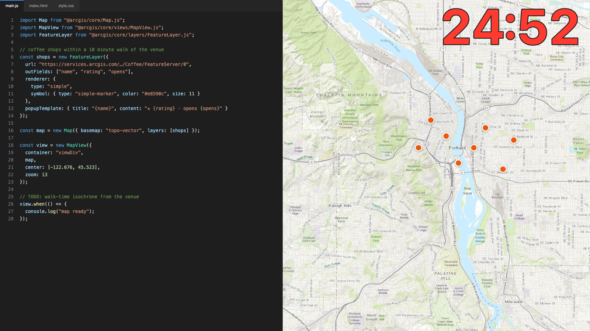
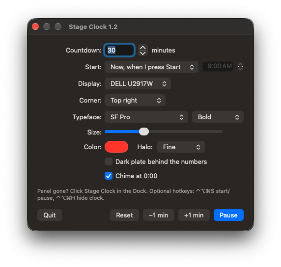

# Stage Clock

A giant countdown clock for live talks. It sits in the corner of your screen, on top of everything, and clicks pass right through it.

I built it for the talks where I vibe code something in 30 minutes on stage. The audience can see the clock, I can see the clock, and nobody has to wonder how it's going.



## What it does

- Big red countdown in any corner, on any display. Transparent, always on top, click-through.
- Counts into overtime as `+0:12` and flashes, so you know you're over.
- Start now, or at a set time. If your slot already started, it joins in progress and still ends on time.
- Pick any installed typeface, size and color. Optional halo or dark plate so it reads over light maps and dark editors alike.
- Optional chime at 0:00.

The digits are drawn as vector outlines with a crisp halo, not a blurry drop shadow. There are cartographers in these audiences. They will notice.

## Control panel



It opens at launch. Lost it? Click Stage Clock in the Dock, or the time in the menu bar.

Hotkeys work from any app if you want them:

- `⌃⌥⌘S` start / pause
- `⌃⌥⌘R` reset
- `⌃⌥⌘H` hide the clock
- `⌃⌥⌘=` / `⌃⌥⌘-` add or remove a minute

## Install

Grab `StageClock.zip` from [Releases](https://github.com/morehavoc/stage-clock/releases), unzip and drag **Stage Clock** to Applications. macOS 13 or newer, Apple silicon or Intel.

It isn't notarized, so macOS will block the first launch. Go to **System Settings → Privacy & Security** and click **Open Anyway**. Or skip that with:

```sh
xattr -dr com.apple.quarantine "/Applications/Stage Clock.app"
```

## Build it yourself

Needs the Xcode command line tools.

```sh
./build.sh
```

That makes a universal `build/Stage Clock.app` and `build/StageClock.zip`. It's one Swift file, no Xcode project.

For testing: `--test-seconds 90` starts a 90 second countdown right away, and `--specimen out.png` renders every typeface over a dark editor, a light editor and a map.

## License

MIT
